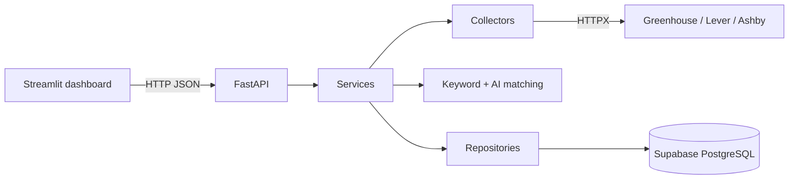

# JobRadar AI

A locally run job discovery and resume-matching app. You give it your resume, a list of
target companies and search keywords; it pulls open jobs from company career boards,
keeps the ones that match **any** of your keywords, scores them against your resume with
a small CPU embedding model, and shows everything in a dashboard where you can save jobs
and track applications.

It is also a learning project: every part is documented in [`docs/`](docs/)

## The problem it solves

Checking dozens of company career pages for relevant openings is slow and repetitive.
JobRadar AI checks them for you, filters by your keywords, ranks by fit, and remembers
what you have already seen (so you only look at new jobs).

## Features

- **Target companies** (add / edit / enable / disable / delete, CSV and JSON import and export, "test connection")
- **Keyword management** with aliases. **OR logic**: one matching keyword qualifies a job
- Resume upload (PDF/DOCX), skill extraction, manual correction, multiple versions
- Collectors for **Greenhouse, Lever and Ashby** public job-board APIs
- Hybrid AI relevance score (skills, semantic similarity, title, experience, keywords)
  with matched/missing skills, excerpts and a plain-language explanation
- Streamlit dashboard: Dashboard, Job Results (filters), Saved Jobs, Application Tracker, Settings
- Duplicate detection, expired-job detection, new-job detection
- Optional email digests (SMTP) and an optional scheduler
- Data in Supabase PostgreSQL; your original resume never leaves your machine

## Supported job sources, and what is deliberately not supported

| Source | Status |
|---|---|
| Greenhouse job boards | supported |
| Lever postings | supported (US and EU) |
| Ashby job boards | supported |
| LinkedIn, Naukri, Foundit, Indeed | **not supported.** They have no public job-search API for this use, and scraping them breaks their terms of service and gets accounts blocked. |

Any company that hosts its careers on Greenhouse, Lever or Ashby works, whichever country
it hires in. Adding a new source later means one new collector class
(see [docs/06](docs/06-job-collection-and-apis.md)).

## Technology

Python 3.12, FastAPI, SQLAlchemy 2 + Alembic, psycopg 3, Pydantic, HTTPX, Streamlit,
sentence-transformers (`all-MiniLM-L6-v2`, CPU), scikit-learn, NumPy, PyMuPDF, python-docx,
APScheduler, Pytest, Ruff.

## Architecture



Details: [docs/02-system-architecture.md](docs/02-system-architecture.md).

## Quick start

Full step-by-step instructions (Ubuntu 24.04 on WSL2, Supabase setup, troubleshooting):
**[docs/13-setup-and-installation.md](docs/13-setup-and-installation.md)**.

```bash
git clone https://github.com/akhila-dev5/JobRadar.git && cd JobRadar
python3.12 -m venv .venv && source .venv/bin/activate
pip install torch --index-url https://download.pytorch.org/whl/cpu
pip install -r requirements.txt
cp .env.example .env            # then put your Supabase connection string in DATABASE_URL
alembic upgrade head            # create the tables
python scripts/check_db.py      # verify the connection

uvicorn backend.app.main:app --port 8000          # terminal 1
streamlit run frontend/dashboard.py               # terminal 2
```

## Using it

1. **Settings > Resume**: upload a PDF/DOCX, fix the detected skills.
2. **Settings > Keywords**: add keywords (a job qualifies if *any* enabled keyword appears in its title or description).
3. **Settings > Companies**: add a company, choose the platform, enter its board token (the slug in its careers URL, e.g. `jobs.lever.co/<token>`), press **Test**.
4. **Dashboard**: press **Search all enabled companies**. Results appear under **Job Results**.

## How AI matching works (short version)

Keyword qualification decides *whether a job is stored and shown*. The AI score decides
*how it is ranked*. A job that matches a keyword is never discarded because of a low
score; the 40% threshold (configurable, can be switched off) only filters the default
view and email alerts. The score is a relevance ranking, not a chance of getting hired.
See [docs/07](docs/07-ai-and-semantic-matching.md) and [docs/08](docs/08-keyword-matching-logic.md).

## Testing

```bash
pip install -r requirements-dev.txt
pytest          # network, SMTP and database are all faked; the real DB is never touched
ruff check .
```

## Limitations

- Only companies on Greenhouse / Lever / Ashby; no LinkedIn, Naukri or Foundit (see above)
- Resume parsing is heuristic (regex + a skill dictionary). Scanned image PDFs are not supported
- Experience requirements are parsed from text like "3+ years"; unusual phrasing is missed
- Single-user app with no login. Keep the API on `127.0.0.1`
- Supabase free projects pause after about a week of inactivity

More in [docs/15-future-improvements.md](docs/15-future-improvements.md).

## Documentation

`docs/` has one file per topic, from [Python fundamentals](docs/03-python-fundamentals.md)
to [testing](docs/12-testing-and-debugging.md), each ending with interview questions.
