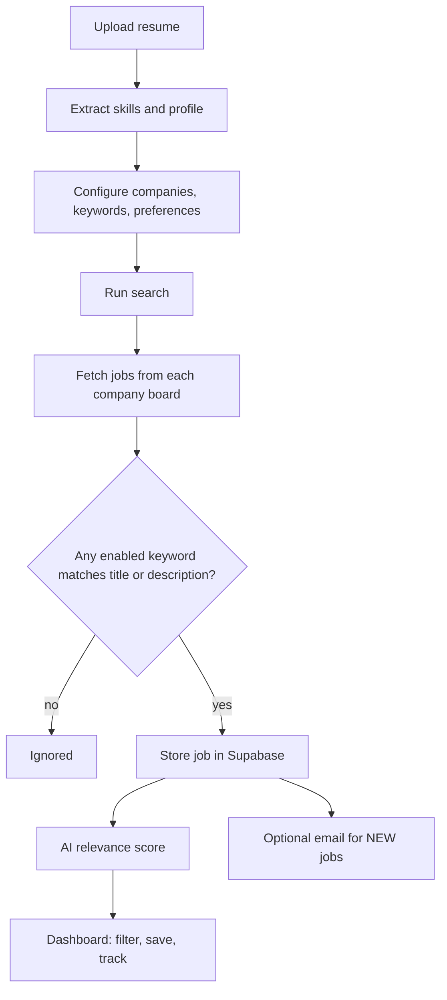

# 01 - Project Overview

## What JobRadar AI is

A personal job-search assistant that runs on your laptop. It automates the loop you would
otherwise do by hand: open a company's careers page, scan the list, decide whether a job
fits, remember what you already saw.

## The workflow

## Two ideas to keep separate

| Idea | Question it answers | Where |
|---|---|---|
| **Keyword qualification (OR)** | Is this job a candidate at all? | `matching/keyword_matcher.py` |
| **AI relevance score** | How well does it fit my resume? | `matching/scoring.py` |

They never influence each other. The 40% AI threshold is a display and notification
filter; it never removes a keyword-qualified job from the database.

## Design goals (and how they show up in the code)

- **Runs locally, free**: no paid APIs, CPU-only model, no Docker needed.
- **Works without an LLM**: all scoring is embeddings plus arithmetic.
- **Your data stays yours**: the resume file stays in `data/resumes/`; only extracted skills,
  titles and a condensed profile text go to the database.
- **Extensible**: new job source = one new class; new keyword = a row, not a code change.
- **Safe to test**: tests use in-memory SQLite and fake HTTP/SMTP; a guard stops tests from
  using the real database (`database/session.py`).

## What it will not do

- Scrape LinkedIn, Naukri, Foundit or Indeed. They have no public job-search API for this,
  and scraping violates their terms. Only official public board APIs are used.
- Predict whether you will get an interview or offer.
- Apply to jobs for you.

## Tech at a glance

See [02-system-architecture.md](02-system-architecture.md) for how the pieces connect and
why each was chosen.

## Interview questions this project prepares you for

- Walk me through a project you built end to end. What were the trade-offs?
- How do you separate business logic from the web layer?
- How would you add a new data source without touching existing code?
