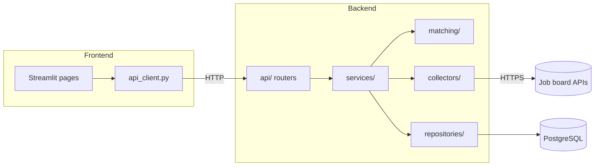
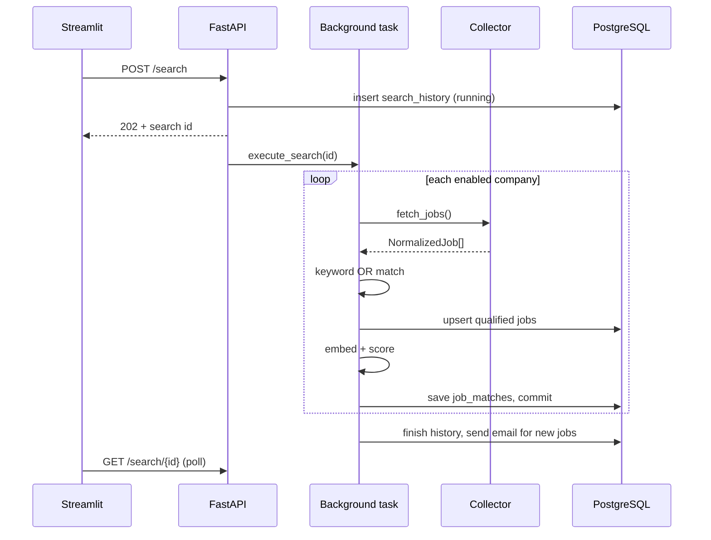

# 02 - System Architecture

## Layers

| Layer | Folder | Rule |
|---|---|---|
| Frontend | `frontend/` | Never touches the database. Talks to the API only. |
| Routers | `backend/app/api/` | HTTP in/out and validation. No business logic. |
| Schemas | `backend/app/schemas/` | Pydantic models = the API contract. |
| Services | `backend/app/services/` | Use-cases: upload resume, run search, notify. |
| Matching | `backend/app/matching/` | Pure logic: keyword matcher, skills, scoring, embeddings. |
| Collectors | `backend/app/collectors/` | One class per job platform behind one interface. |
| Repositories | `backend/app/repositories/` | All SQL/ORM access. |
| Models | `backend/app/models/` | SQLAlchemy tables. |

Why the split: each layer can be tested alone. The keyword matcher has no idea a database
exists, so its unit tests need nothing but strings.

## Request flow: "Run search"

Key choices:

- **202 + background task**: a search can take minutes; the HTTP request must not hang.
- **Commit per company**: a failure in company 5 does not lose companies 1-4.
- **One search at a time**: `HistoryRepository.running()` blocks overlapping runs (409).
- **Errors are collected, not fatal**: a bad board token marks that company failed and the
  search ends as `partial`.

## Patterns used (and where)

| Pattern | Example |
|---|---|
| Strategy / interface | `JobCollector` and its three subclasses |
| Registry | `COLLECTORS` dict + `@register_collector` |
| Repository | `CompanyRepository`, `JobRepository`, ... |
| Dependency injection | `SearchDeps` (HTTP client, embedder factory, notifier) is passed in; tests pass fakes |
| Dependency inversion | `Embedder` protocol with two implementations |
| Unit of work | one SQLAlchemy session per request (`get_db`) |

## Technology choices

| Choice | Why | Alternative and trade-off |
|---|---|---|
| FastAPI | typed validation, auto docs at `/docs` | Flask: simpler, but you hand-write validation |
| SQLAlchemy 2 + Alembic | ORM plus versioned migrations | raw SQL: more control, more boilerplate |
| Supabase Postgres | free hosted Postgres, as you required | local DB: rejected by your constraints |
| Streamlit | dashboard in pure Python | React: nicer UI, much more code |
| MiniLM-L6-v2 | ~90 MB, 384 dims, fast on CPU | larger models: better but slow on 8 GB RAM |
| APScheduler | in-process schedule, no extra services | Celery + Redis: overkill here |

## Interview questions

- Why return 202 for a long-running operation? How would the client learn the result?
- What does the repository pattern buy you? What does it cost?
- How does dependency injection make code testable? Show an example from this repo.
