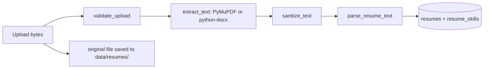

# 05 - Resume Processing

Code: `services/resume_parser.py`, `services/resume_service.py`, `matching/skills.py`,
`data/skills.json`. Tests: `tests/unit/test_resume_parser.py`.

## Pipeline

## Validation (security)

`validate_upload` runs before any parser touches the data:

1. Not empty; not larger than `MAX_UPLOAD_MB` (the endpoint also never reads more than
   limit + 1 bytes, so a huge upload cannot exhaust memory).
2. Extension is `.pdf` or `.docx`.
3. **Magic bytes** match: PDFs start with `%PDF-`, DOCX files are zip containers (`PK\x03\x04`).
   A renamed `.exe` is rejected even if it is called `resume.pdf`.
4. Password-protected PDFs and unreadable files give a clear message, not a stack trace.
5. Image-only (scanned) PDFs are rejected: fewer than 30 characters of text were found.

`sanitize_text` normalises Unicode (NFKC), strips control characters, collapses whitespace
and caps length at 200,000 characters.

## Structuring

Heuristics, not machine learning, so results are explainable and fast:

- **Sections** are found by heading lines (Experience, Education, Certifications, Skills, Summary...).
- **Skills** come from a dictionary (`skills.json`: languages, frameworks, databases, cloud,
  tools) with aliases. The same extractor reads job descriptions, which is what makes
  "matched skills" and "missing skills" comparable. Ambiguous short names (`Go`, `R`, `C`,
  `Swift`, `Ruby`, `Rust`, `Oracle`, `Scala`) match case-sensitively so "go to market" is not "Go".
- **Job titles**: lines in the experience section that contain words like engineer, developer, analyst.
- **Education**: lines with degree patterns (B.Tech, M.Sc, MBA...).
- **Certifications**: the Certifications section, else lines containing "certified/certification".
- **Years of experience**: date ranges ("Jan 2019 - Present") are merged so overlapping jobs
  are not double counted; a stated "6+ years" is also considered and the larger value wins.

## Privacy

| Data | Where it lives |
|---|---|
| Original PDF/DOCX | `data/resumes/` on your machine only (gitignored) |
| Skills, titles, education, certifications, years | Supabase |
| `profile_text` | Supabase: a short summary + titles + skill list used for embeddings, not the full resume |

Deleting a resume (Settings > Resume > Delete) removes its database rows and skills
(cascade). The API can also delete the local file with `delete_local_file=true`.
Uploading the same file twice is detected by SHA-256 and just re-activates it.

## Manual correction

Add or remove skills, edit titles/education/certifications/years in Settings > Resume. Manual
skills are tagged `source = manual`. Edits rebuild `profile_text` so the next scoring uses them.
Several resume versions can exist; one is **active** and used for scoring.

## Limitations

Layout-heavy PDFs (multi-column, tables) can reorder text. Skills not in the dictionary are
not detected automatically (add them by hand or extend `skills.json`). Section detection
needs conventional headings.

## Interview questions

- Why validate file content (magic bytes) and not just the extension?
- What are the trade-offs between regex heuristics and an ML/NLP extractor?
- How do you merge overlapping date intervals? (Sort, then sweep.)
- What does `ON DELETE CASCADE` do, and when is it dangerous?
