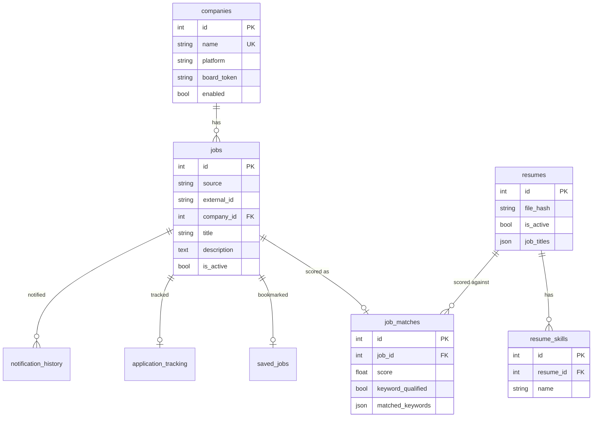

# 09 - Database Design

Models: `backend/app/models/entities.py`. Migration: `backend/alembic/versions/0001_initial_schema.py`.

## ER diagram



Standalone tables: `search_keywords`, `job_preferences` (one row, id = 1), `search_history`,
`embedding_cache`.

## Tables

| Table | Purpose |
|---|---|
| companies | target companies: platform, board token, enabled, last search/success/error, jobs collected |
| search_keywords | keyword, aliases (JSON list), enabled |
| job_preferences | titles, locations, work modes, experience, salary, AI threshold + on/off, weights, email settings |
| resumes / resume_skills | extracted profile per resume version; skills with category and auto/manual source |
| jobs | normalised postings, content hash, first/last seen, active flag |
| job_matches | score, breakdown, matched keywords/skills, missing skills, excerpts, explanation |
| saved_jobs | bookmarks |
| application_tracking | status, notes, applied date |
| search_history | each run: status, counts, errors |
| notification_history | which job was emailed (prevents repeats) |
| embedding_cache | vectors keyed by text hash + model |

## Constraints that matter

| Constraint | Why |
|---|---|
| `UNIQUE (source, external_id)` on jobs | the duplicate-prevention rule |
| `UNIQUE (platform, board_token)` and unique name on companies | no accidental double entries |
| `UNIQUE (job_id)` on job_matches, saved_jobs, application_tracking | one row per job |
| `UNIQUE (job_id, channel)` on notification_history | a job is notified once |
| `UNIQUE (resume_id, name)` on resume_skills | no duplicate skills |
| Foreign keys with `ON DELETE CASCADE` | deleting a job or resume removes its dependants |
| `jobs.company_id ... ON DELETE SET NULL` | deleting a company keeps its jobs, so saved/tracked jobs survive |

Indexes: `jobs(first_seen_at)`, `jobs(is_active, company_id)`, `job_matches(keyword_qualified, score)`,
`application_tracking(status)`, `resumes(file_hash)`, plus the unique constraints.

## Key query, explained

The Job Results list (`JobRepository.query`) is, in effect:

```sql
SELECT jobs.*, job_matches.*
FROM jobs JOIN job_matches ON job_matches.job_id = jobs.id
WHERE jobs.is_active
  AND job_matches.keyword_qualified
  AND job_matches.score >= :min_score        -- AI threshold, a display filter
  AND lower(jobs.company_name) LIKE :company -- other filters are added only if set
ORDER BY job_matches.score DESC
LIMIT :limit OFFSET :offset;
```

All values are bound parameters (never string-formatted), which prevents SQL injection.
The keyword filter is applied in Python over a JSON list so the same code runs on PostgreSQL
and on the SQLite used in tests; at single-user scale this is fine.

## Migrations (Alembic)

Think of migrations as Git for your schema. `alembic upgrade head` applies pending ones;
`alembic revision --autogenerate -m "add x"` drafts a new one after you change a model (always
read the draft). The database URL is read from the environment, not from `alembic.ini`.

The initial migration also runs `ALTER TABLE ... ENABLE ROW LEVEL SECURITY` on every table
(PostgreSQL only). Supabase exposes `public` tables through its REST API guarded by RLS;
enabling RLS with no policies means the public keys can read nothing, while this app, which
connects directly as the owner, is unaffected.

## Connection handling

`database/session.py`: a small pool (3 + 2 overflow) for the free tier's connection limit,
`pool_pre_ping` to survive idle drops and paused projects, and `prepare_threshold=None` so
it also works through Supabase's transaction pooler. One session per request, committed on
success and rolled back on error.

## What was and was not verified

The migration was applied and rolled back on SQLite, and rendered as PostgreSQL SQL (offline
mode) to confirm it compiles. It has **not** been run against a live Supabase database in
the build environment (no database access). Running `alembic upgrade head` followed by
`python scripts/check_db.py` on your machine is the real check.

## Interview questions

- Primary key vs unique constraint vs index?
- What is a foreign key? Compare `CASCADE` and `SET NULL`.
- How would you find duplicate jobs with SQL? (`GROUP BY source, external_id HAVING count(*) > 1`)
- What is an N+1 query problem? Where does `joinedload` appear here?
- What are database migrations and why are they needed?
