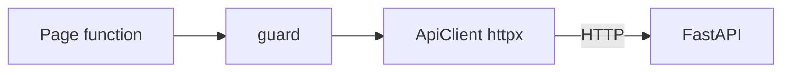

# 11 - Frontend and Dashboard (Streamlit)

Code: `frontend/dashboard.py`, `frontend/api_client.py`, `frontend/views/`.

## How Streamlit works

A Streamlit script is **re-run top to bottom on every interaction** (a click, a typed
filter). State that must survive a rerun lives in `st.session_state`. That is why code such
as "start search, poll, store the outcome in session_state, then `st.rerun()`" looks the way
it does in `pages_main.py`.

## Responsibilities

The frontend never imports the backend and never sees database credentials. Everything
goes through `api_client.py`, a thin HTTPX wrapper whose base URL is `API_BASE_URL`.
If the API is down you get "Cannot reach the backend at ..." instead of a stack trace.



`guard()` calls the API and turns any error into a friendly `st.error`, returning `None`.

## Pages

| Page | Contents |
|---|---|
| Dashboard | jobs stored, qualified, above threshold, new (7 days), companies monitored, last successful search; search-all and search-selected buttons with live progress; company status table |
| Job Results | filters (company, title, keyword, location, minimum score, source, date, sort), paged job cards (25 per page) with score, matched keywords/skills, missing skills, published date, source, direct apply link; detail view with highlighted description and explanation; save button |
| Saved Jobs | bookmarked jobs, including those below the AI threshold |
| Application Tracker | status (discovered, interested, applied, interviewing, rejected, offer received), notes, applied date |
| Settings | tabs: Companies (add, edit, enable/disable, test, delete, CSV/JSON import/export), Keywords (with aliases and a Test match tool), Preferences (titles, locations, work mode, experience, salary, AI threshold on/off, email), Resume (upload, activate, edit skills, delete) |

## The AI threshold in the UI

Job Results hides jobs under the threshold by default; the checkbox "Include jobs below my
AI threshold" shows them. Hidden does not mean deleted: they stay in the database and still count
as "qualified" on the dashboard.

## Why Streamlit

Pure Python, no JavaScript build step, fast to iterate. Trade-offs: it reruns the script on
each interaction, has limited layout control, and is not meant for many concurrent users.
Because the API is a separate process, replacing the UI later (React, for example) needs no
backend change.

## Run it

```bash
streamlit run frontend/dashboard.py          # needs the API running on API_BASE_URL
```

## Common errors

| Symptom | Fix |
|---|---|
| "Cannot reach the backend" | start uvicorn; check `API_BASE_URL` in `.env` |
| Widget loses its value | put it in `st.session_state` or give it a stable `key=` |
| Everything reruns on each click | expected; cache slow calls or keep them behind buttons |

## Interview questions

- What is the difference between a stateless and a stateful UI? How does Streamlit keep state?
- Why should the UI talk to an API instead of the database?
- What is CORS and why was it not needed here? (The browser talks to Streamlit, and Streamlit's
  Python process calls the API server-side.)
